# Church Inventory

A small, self-hosted web app for a parish or church community to keep track of:

- **Inventory**: what the church owns, where it is, its condition, photos, serial numbers and purchase info, with **printable QR labels**.
- **Events**: who did which event (Mass/service, conference, recording, meeting, cleanup, concert, repair, or your own types), when, a short write-up and photos.
- **Rooms and spaces** (parish hall, meeting room, kitchen, the church itself) are booked the same way as items and show up in the same calendar, with the same clash warning.
- **Maintenance and inspections**: recurring tasks such as fire extinguisher checks, electrical inspections (revízie), organ tuning or boiler service, with due dates, a responsible person or contractor, reminders by email/WhatsApp (14, 7 and 1 day before, then weekly while overdue), and a history of the work done with photos, result and cost.
- **Donations and asset value**: how each item was acquired (purchase or donation, and from whom), its value, and straight-line depreciation over its useful life. A yearly **assets and donations report** for the diocese or the insurer can be printed, saved as PDF or downloaded as CSV.
- **Reservations and borrowing**: request, approve, hand out and return items, with a **clear warning when bookings clash** (quantity-aware: 10 chairs can be booked by several people as long as no more than 10 are out at once).
- **Audit trail**: every change is recorded with who, when, and exactly what changed (before → after). The log is **append-only and hash-chained**, so it can serve as evidence. Records are edited with full history and archived instead of deleted. Photos are never deleted, only hidden.
- **Calendar**: each person gets a private calendar link (iCal) for Google Calendar, Outlook or iPhone that shows events and reservations and updates automatically.
- **Notifications** by **email** and **WhatsApp**: new reservation requests (with the clash warning), approvals and rejections, a reminder the day before, overdue returns, maintenance due dates, and a daily audit fingerprint for auditors.
- **Slovak and English** interface (Slovak by default; each person can switch).
- **Nightly backups** of the database and photos.

It runs in a single Docker container with an SQLite database and is light enough for a **Raspberry Pi 4/5**, a mini PC or any home server.

License: **GNU AGPL-3.0**. You can use, change and share it freely. If you run a modified version for others, you must share your changes (the app links to its source code in the footer).

## Screenshots

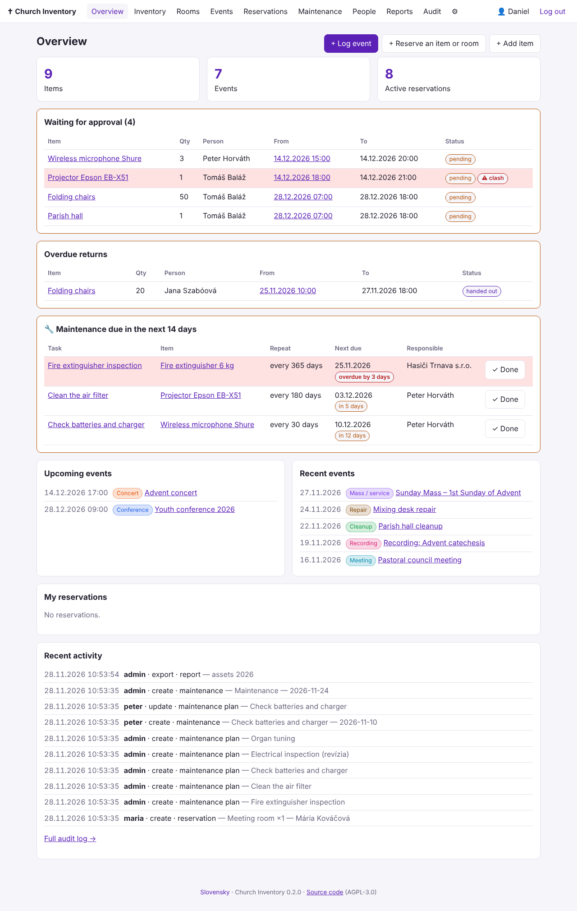

| | |
|---|---|
| **Inventory** with photos, categories, locations and condition<br>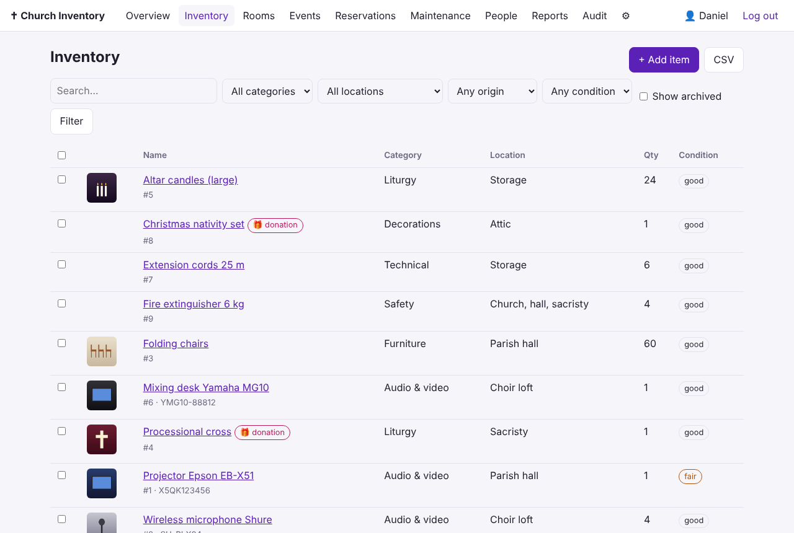 | **Item detail** with QR code, reservations and the full change history<br>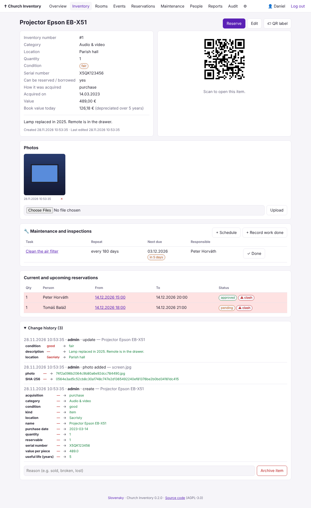 |
| **Event** with participants, write-up, photos and items used<br>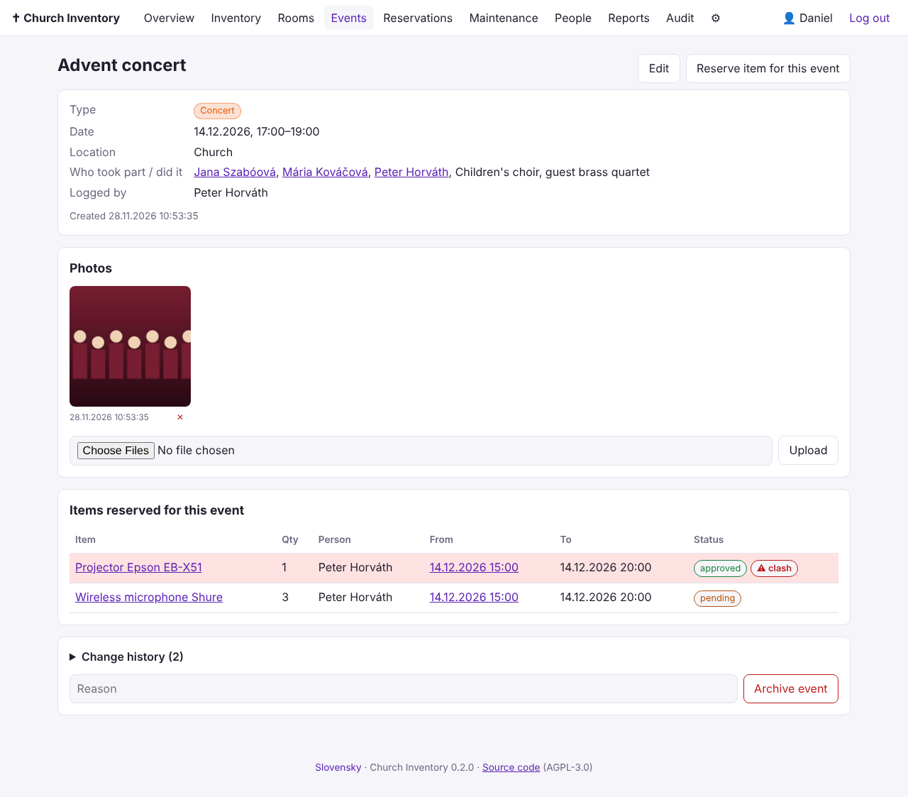 | **Events log**, filterable by type, person and date<br>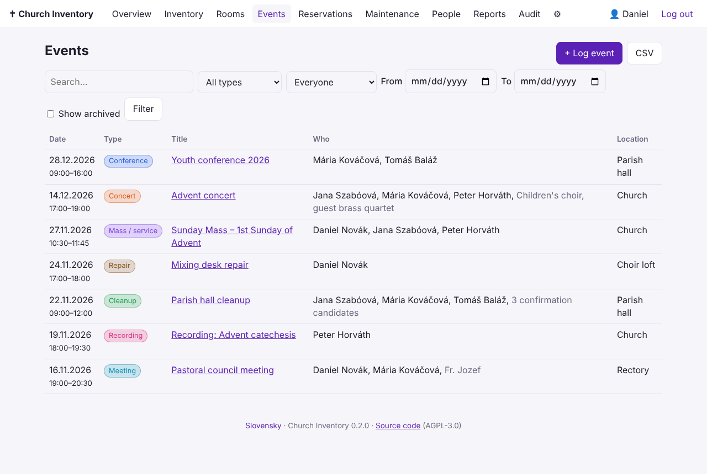 |
| **Rooms and spaces**, booked like items<br>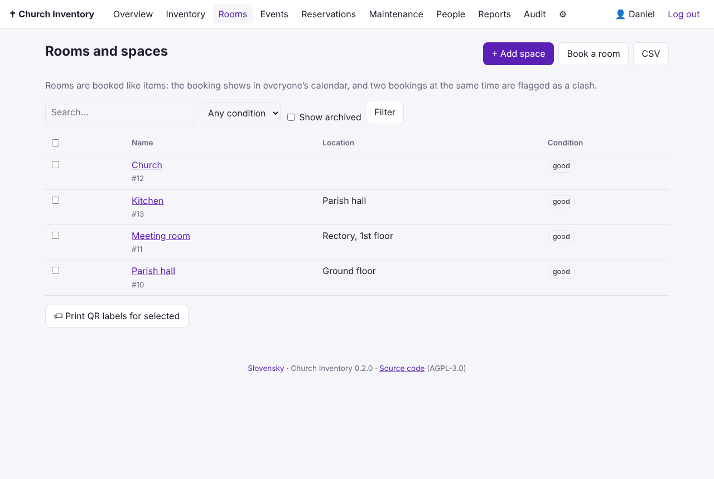 | **Maintenance and inspections** with due dates and history<br>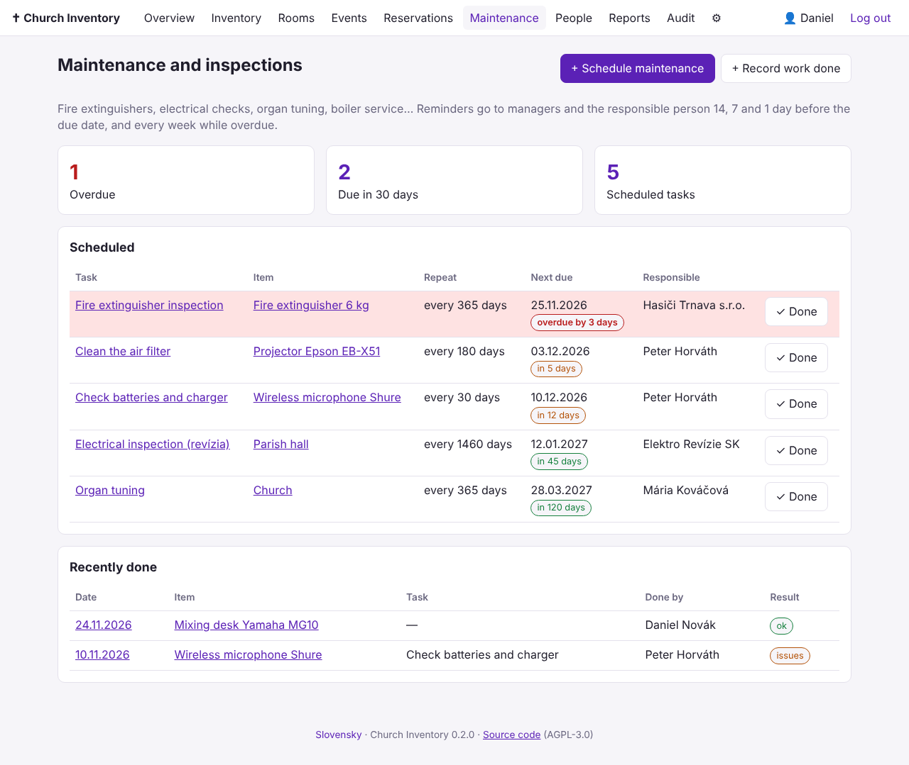 |
| **Assets and donations report** for the diocese or insurance (print, PDF, CSV)<br>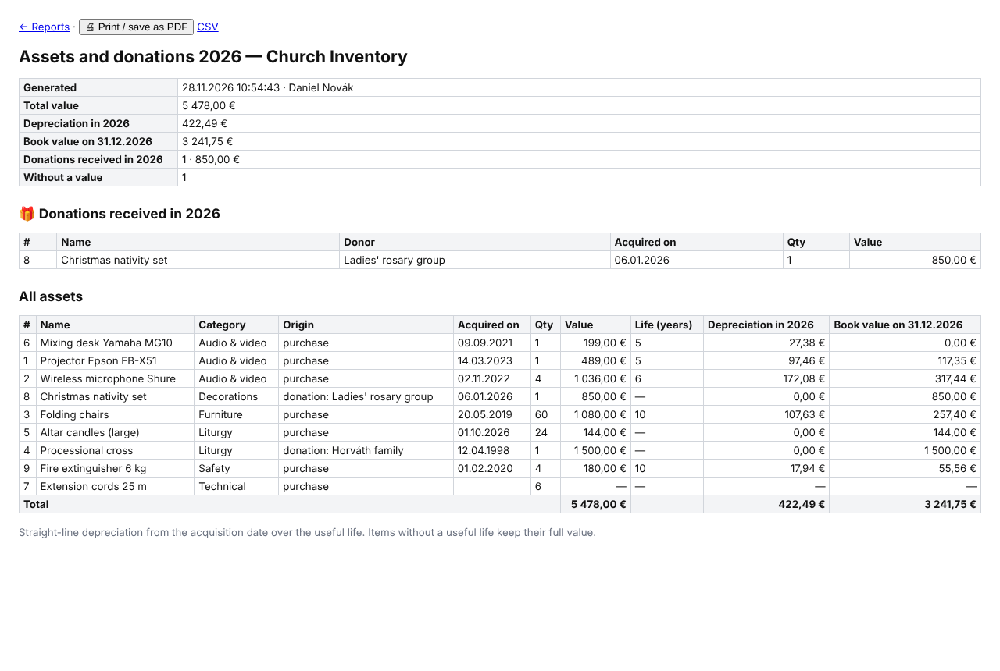 | **Overview** for managers: approvals, overdue returns, maintenance due<br> |
| **Clash warning** while booking, shown live as you pick the time<br>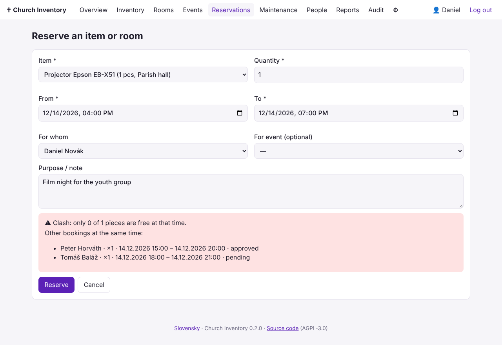 | **Reservations** with clashes highlighted<br>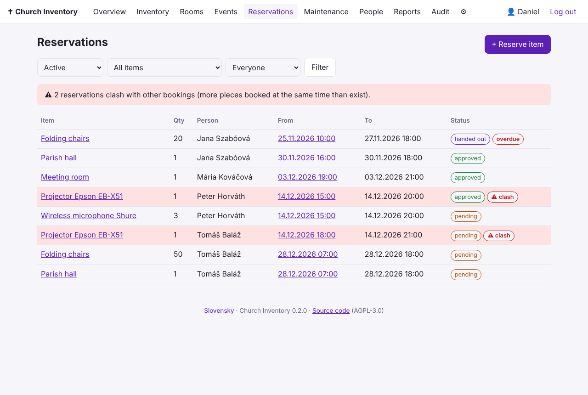 |
| **Audit log**: who changed what and when, before → after, with integrity check<br>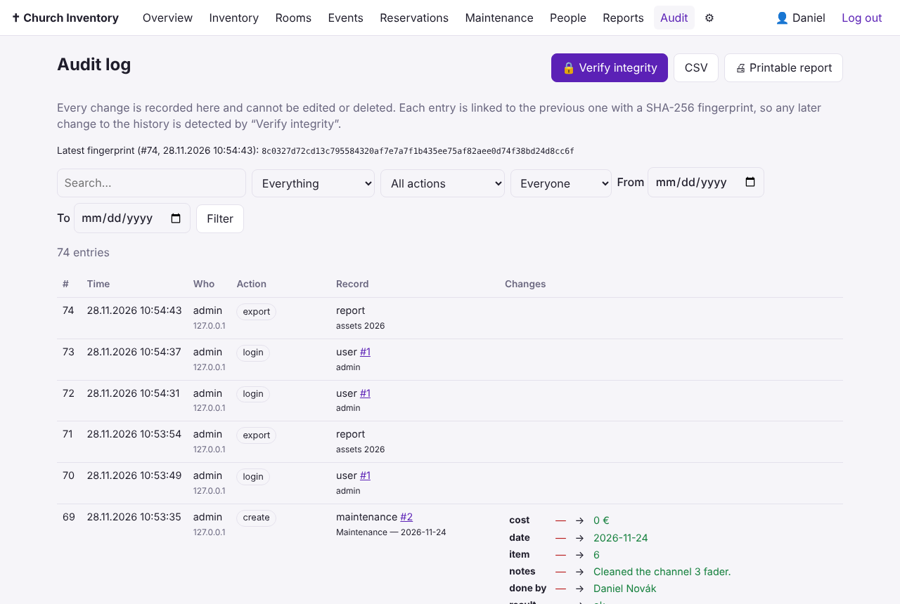 | **People** and how many events each person did<br>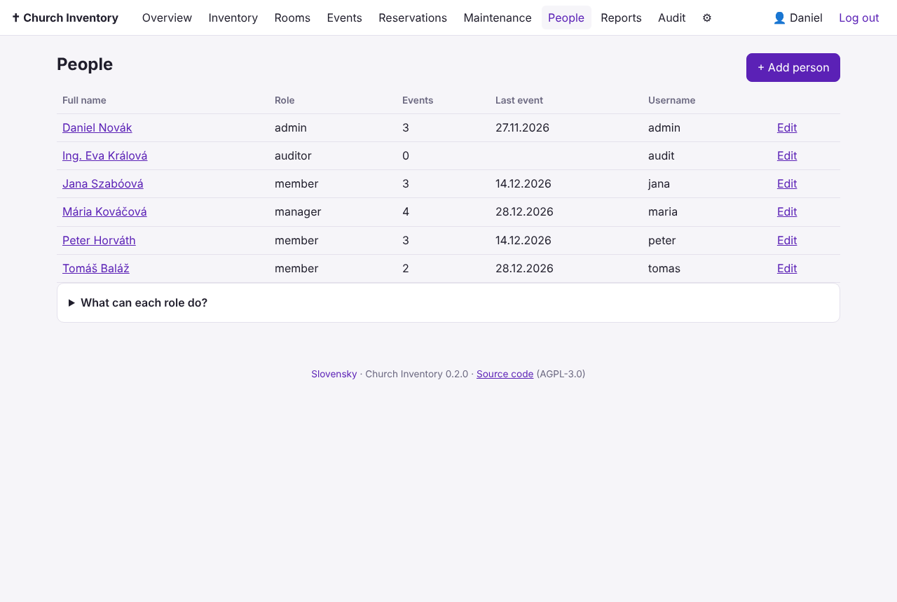 |
| **Calendar link** for Google, Outlook and iPhone<br>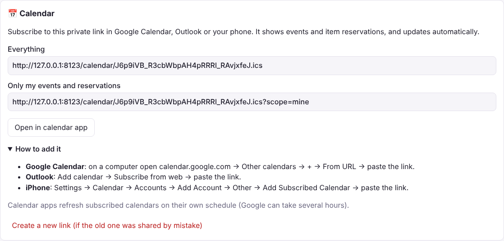 | **Printable QR labels**<br>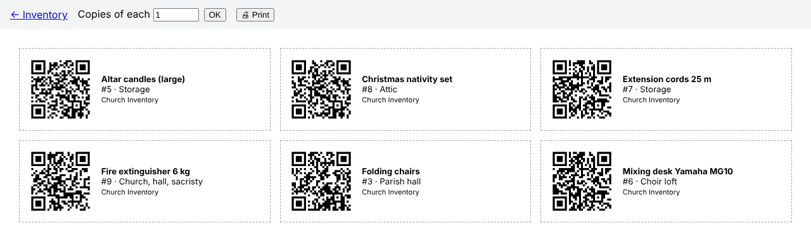 |
| **Slovak interface**<br>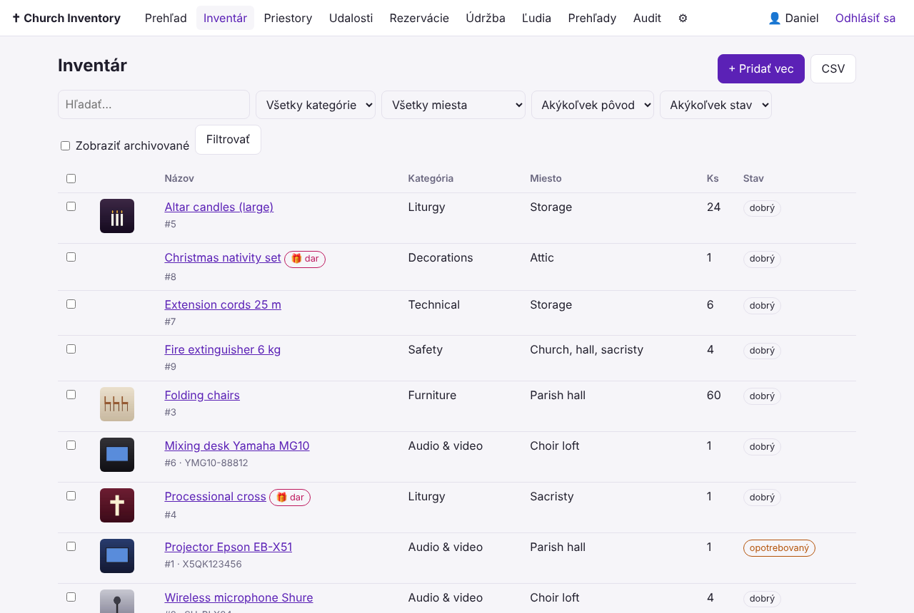 | **Phone, dark mode**<br>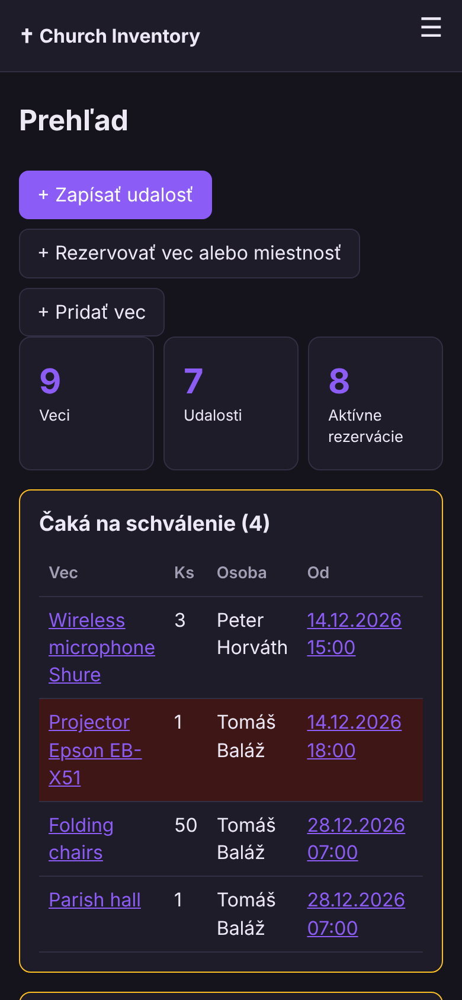 |

---

## Roles

| Role | Can do |
|---|---|
| **Admin** | Everything, including people, event types, backups and settings |
| **Manager** | Manage inventory and rooms, approve and hand out reservations, edit any event, plan maintenance, see reports and the audit log |
| **Member** | Log events, edit their own events, request reservations, cancel their own requests, record maintenance work |
| **Auditor** | Read-only access to everything, including the audit log, the asset report, CSV exports and the printable reports |

---

## Install (Raspberry Pi, mini PC or server)

You need Docker. On Raspberry Pi OS (64-bit) or Debian/Ubuntu:

```bash
curl -fsSL https://get.docker.com | sh
sudo usermod -aG docker $USER   # log out and back in afterwards
```

Then:

```bash
git clone https://github.com/dB-Digital-Fox/church-inventory.git
cd church-inventory
cp .env.example .env
nano .env                        # set ORG_NAME, BASE_URL, email/WhatsApp if wanted
mkdir -p data backups && sudo chown -R 1000:1000 data backups
docker compose up -d --build
```

Open `http://<device-ip>:8000` from a computer on the same network. The first visit asks you to create the administrator account. **Do this right away, before exposing the app to the internet.**

Then add people under **People → Add person**. Each person gets a temporary password that they must change at first login.

To update later:

```bash
git pull && docker compose up -d --build
```

The database is upgraded automatically on start and nothing is removed. When upgrading from 0.1, values typed in the old "purchase value" field (like `489 €`) are copied into the new value field. Make a backup first (**Administration → Back up now**) to be safe.

### Which device?

All of these work. Pick based on what you have:

- **Raspberry Pi 5**: quiet, low power (~5 W). Use a **USB SSD instead of the SD card** if you can, since SD cards wear out with constant database writes. Keep backups on a separate USB drive.
- **HP mini PC (EliteDesk/ProDesk G5)**: the most robust choice. It has an internal SSD, is still low power, and is faster. Recommended if it's free.
- **Dell server**: works fine, but uses much more power for an app this small. It makes sense if it's already running 24/7 for other things.

---

## Access from outside the church

Pick one:

- **[Cloudflare Tunnel](docs/cloudflare-tunnel.md)**: public HTTPS address like `https://inventar.yourparish.sk`, no ports opened on your router. Good when many volunteers need access from their phones. Free.
- **[Tailscale](docs/tailscale.md)**: private network, only people you invite can reach the app at all. The most secure option, but everyone needs the Tailscale app.
- **Local only**: do nothing. The app is reachable only inside the church network.

When using HTTPS (both options above), set `SECURE_COOKIES=1` and `BASE_URL=https://…` in `.env`.

---

## Notifications

- **Email**: fill in `SMTP_*` in `.env`. Any mail provider works (e.g. a Gmail/Google Workspace account with an app password, Websupport, Seznam…).
- **WhatsApp**: uses the official WhatsApp Cloud API. See **[docs/whatsapp.md](docs/whatsapp.md)**, which explains the Meta business setup it requires.

People choose in **My profile** whether they want email and/or WhatsApp. Admins can send a test message from **Administration**.

---

## The audit trail (for auditors)

- Every create, edit, archive, photo upload/removal, reservation step, login (including failed ones), password change, export and backup is written to the `audit_log` table, in the same database transaction as the change itself.
- Each entry stores the time (UTC), user, IP address, the record, and the changed fields as before → after values.
- Entries are **chained with SHA-256**: each entry's fingerprint covers its content and the previous entry's fingerprint. Editing, inserting or deleting any past entry breaks the chain. **Audit log → Verify integrity** (or `docker compose exec app flask --app app verify-audit`) recomputes the whole chain.
- The database refuses `UPDATE`/`DELETE` on the log (SQLite triggers).
- Someone with full access to the server could still rebuild the whole chain from scratch. To make that detectable, people with the **Auditor** role receive a daily message with the current fingerprint. Keeping those messages (or noting the fingerprint shown on the audit page) lets you prove later that history wasn't rewritten.
- **CSV export** and a **printable report** (browser → Save as PDF) are on the audit page. Exports are themselves logged.
- Uploaded photos are re-encoded (removing GPS/EXIF data), and their SHA-256 is logged, so a swapped image file is detectable.

---

## Backups and restore

See **[docs/backups.md](docs/backups.md)**. In short: a full backup (database + photos) is written every night to `BACKUP_PATH` (point it at a USB drive), the newest 14 are kept, and admins can create and download backups from **Administration**. The doc also shows how to add an encrypted off-site copy with `rclone`.

---

## Command-line helpers

```bash
docker compose exec app flask --app app verify-audit           # check the hash chain
docker compose exec app flask --app app backup                 # back up now
docker compose exec app flask --app app reset-password daniel  # locked out? temporary password
```

## Try it with demo data

```bash
DATA_DIR=./demo-data python scripts/seed_demo.py     # sample items, events, people, reservations
DATA_DIR=./demo-data flask --app wsgi run            # log in as admin / demo password 1
```

The screenshots above come from this demo data (`scripts/screenshots.js` regenerates them).

## Development

```bash
python3 -m venv .venv && . .venv/bin/activate
pip install -r requirements-dev.txt
python -m pytest -q
DATA_DIR=./data flask --app wsgi run --debug
```

Code layout: `app/views/` (one file per section), `app/templates/`, `app/audit.py` (hash-chained log), `app/translations_sk.py` (Slovak texts, and a test fails if one is missing).
